# Castle Doom 3

A port of **Doom 3** (id Tech 4) to the **Castle Game Engine** (Object Pascal / Free Pascal), the sibling of [mariuz/castle-quake1](https://github.com/mariuz/castle-quake1), [mariuz/castle-quake2](https://github.com/mariuz/castle-quake2) and [mariuz/castle-doom](https://github.com/mariuz/castle-doom).

It reads Doom 3's own file formats at runtime: PK4 archives, `.proc` render geometry, `.map` entities, `.mtr` materials with diffuse / normal / specular maps, `.md5mesh` / `.md5anim` skeletal models, `.lwo` / `.ase` static models, `.cm` collision models, entity, model, skin and sound declarations. Doom 3's data is not redistributable, so a small **original test level in real Doom 3 formats** (`data/base/castle_doom3_test.pk4`, generated by `tools/make_test_pk4.py`) is bundled. Point the game at a Doom 3 install to load its maps.

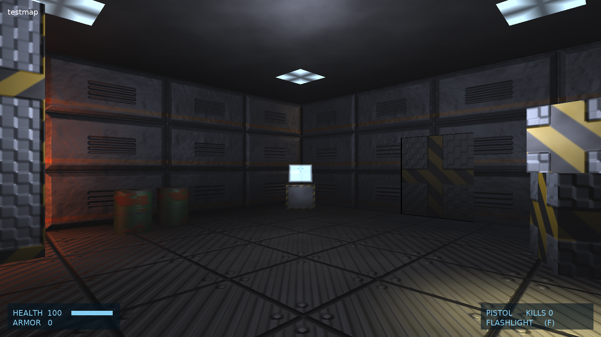

- 📖 **[Architecture & Engine Mapping](docs/ARCHITECTURE.md)**
- 🗺️ **[Doom 3 Comparison & Roadmap](docs/ROADMAP.md)**
- 📝 **[Changelog](docs/CHANGELOG.md)** · **[Releases](https://github.com/mariuz/castle-doom3/releases)** (Windows, Linux)

| | |
|---|---|
| 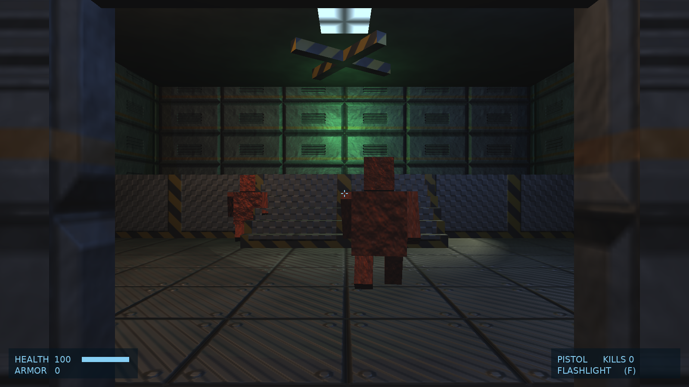 | 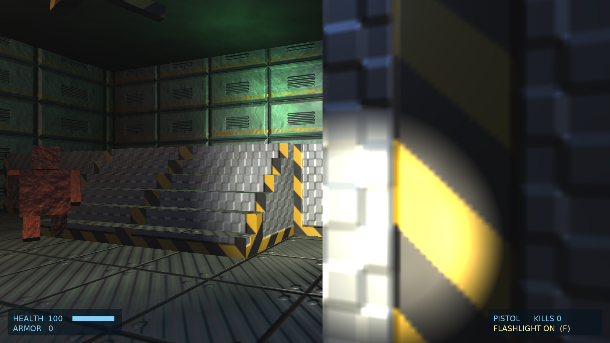 |
| 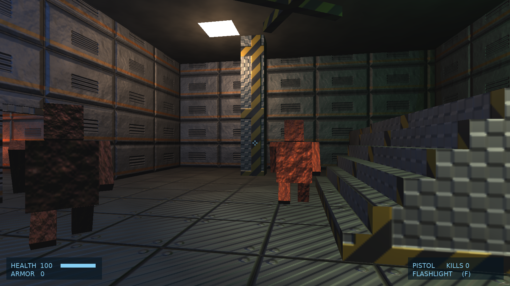 | 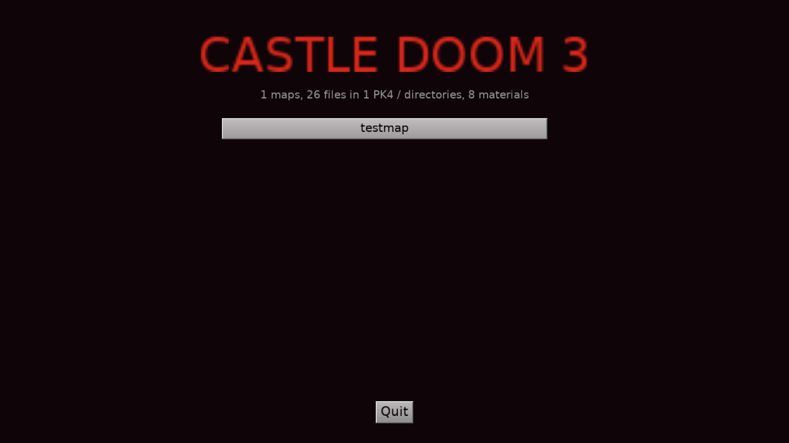 |
| 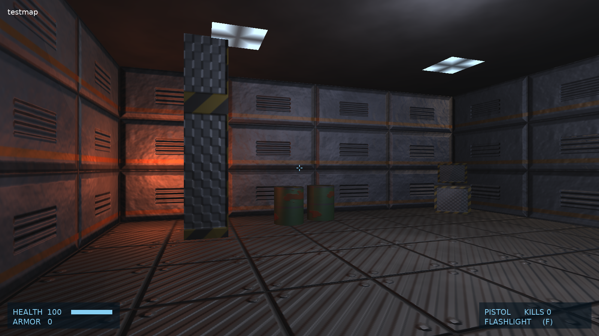 | 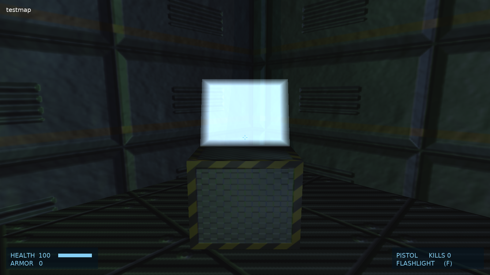 |
| 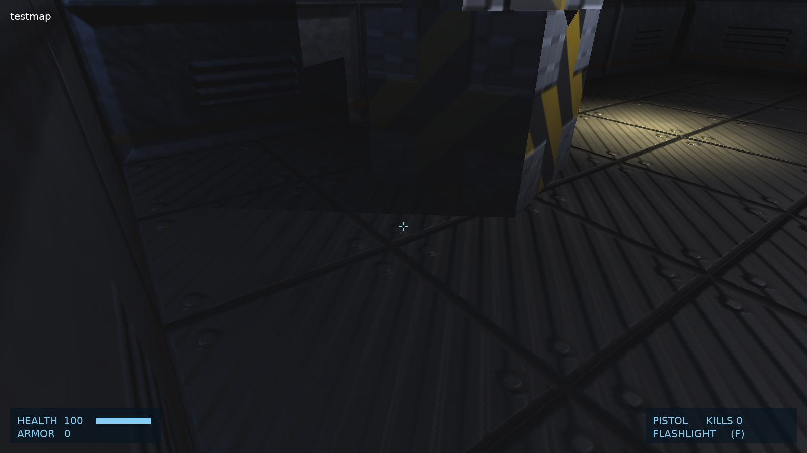 | 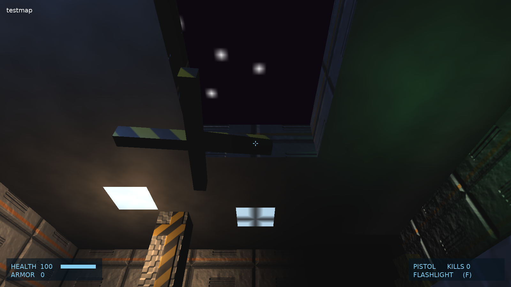 |
| 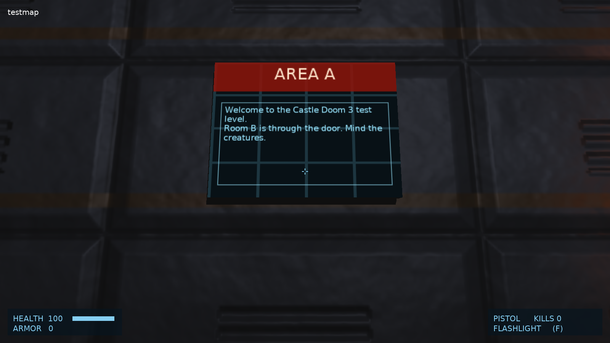 | 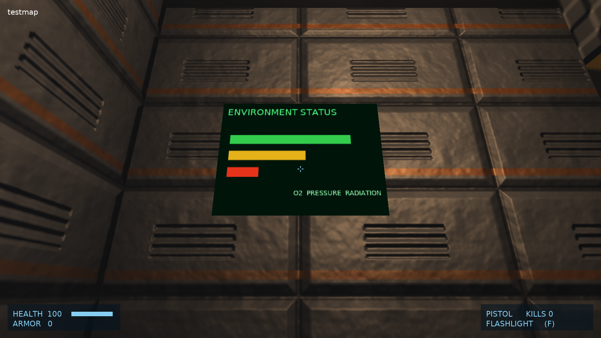 |

---

## Features (and the Castle Game Engine parts they use)

| Doom 3 | Castle Game Engine |
|---|---|
| PK4 archives (`base/pak000.pk4` ...), loose files, later sources override earlier ones | `Doom3Files`: own ZIP central-directory reader with inflate (`ZStream`), served through the `d3fs:` URL protocol (`RegisterUrlProtocol`) |
| `.proc` areas (`_area0`...), brush entity models, portals, area BSP | X3D nodes built in code: `TIndexedTriangleSetNode` with `TNormalNode` and `TTextureCoordinateNode`, one shape per area and material in one `TCastleScene` with `PreciseCollisions` |
| `.mtr` materials: `diffusemap` / `bumpmap` / `specularmap` (or `blend diffusemap` stages), `translucent`, `twoSided`, `nonsolid`, `alphaTest`, blended stages (`blend add`, `blend blend`, `blend filter`) | Phong `TMaterialNode` with `DiffuseTexture`, `NormalTexture` (CGE computes tangents) and `SpecularTexture`; unlit `TUnlitMaterialNode` + `TBlendModeNode` for glows and decals |
| Image programs: `heightmap()`, `addnormals()`, `makeIntensity()`..., Doom 3's normal map convention | `Doom3Images` evaluates them and serves the result through the `d3img:` protocol (green channel flipped for CGE's tangent space) |
| `.tga`, `dds/*.dds` textures | CGE's TGA and DDS loaders via `d3fs:` URLs, shared through CGE's texture cache |
| Per-pixel lights (`light` entities: `light_radius`, `light_center`, `_color`, projected `light_target` / `light_up` / `light_right` / `light_start` / `light_end`, `ambientLight` shaders, `start_off`) with Doom 3's **light volumes**: no distance attenuation, a box (point lights) or frustum (projected lights) mapped to the light's texture space like `lightProject`, projection and falloff shaping | X3D `TPointLightNode`s with `Global` and a `Radius` (CGE gives each light only to shapes it reaches) and a per-light `Effect` plugging `PLUG_light_scale`, reading the fragment's world position from `castle_vertex_eye` and the `EyeWorldSpace` shader library (`Doom3LightEffects`) |
| The flashlight | a `TCastleSpotLight` child of the camera, designed in the editor |
| `.md5mesh` / `.md5anim` skeletal models, model decls (`mesh`, `anim`, `offset`, `inherit`), skins | `Doom3Md5`: CPU skinning into a `TCoordinateNode` each frame, interpolated frames, one `TCastleScene` per instance |
| `.lwo` (LightWave LWO2: `PNTS`, `POLS`, `PTAG`, `TAGS`, `VMAP` / `VMAD` UVs) and `.ase` (3ds Max ASCII: sub-materials, `*BITMAP` → material) static models for `func_static`, props, light fixtures, items, LWO doors | `Doom3StaticModels`: Doom 3's coordinate swaps and face flips, Doom-style smooth normals (shared position and UV), one `TCastleScene` per entity; map geometry (`func_*`) collides unless `noclipmodel` |
| `.cm` collision models (vertices, signed edges, nodes, polygons with materials, brushes) with Doom 3's invisible `playerclip` brushes; contents from material surface parameters (`playerclip`, `monsterclip`, `nonsolid`, `water`, `trigger`...) | `Doom3Collision`: the world model's player-blocking polygons as an invisible scene (`Visible := False`, `PreciseCollisions`) that the player and monster sight collide with; the render scene stays pickable for shots |
| GUIs: `.gui` windowDef trees (`rect`, `backcolor`, `matcolor`, `background`, `bordercolor` / `bordersize`, `text` with `gui::` state from the entity's `gui_*` keys, `textscale`, `textalign`, `forecolor`, `visible`) on `guisurf` surfaces (`entity`, `entity2`, `entity3` or a path) | `Doom3Gui`: a software renderer into a 640 x 480 `TRGBAlphaImage` with CGE's built-in UI font glyphs, served by the `d3gui:` URL protocol and shown with an unlit texture |
| Material stages: texture matrices (`scroll` / `translate`, `scale`, `centerScale`, `shear`, `rotate`) and color registers (`rgb`, `alpha`...) on surfaces with expressions, so screens scroll and panels pulse; `cameraCubeMap` / `cubeMap` skies (with `texgen skybox`); every plain stage (glows over lit walls), `deform sprite`, glass (materials whose only stages are reflections / heat haze) | `TextureTransformMatrix3D` nodes and unlit material colors updated every frame (`UpdateAnimatedSurfaces`); the sky's six images on a `TCastleBackground`, sky surfaces left undrawn; more stages are copies of the surface 0.25 units in front with their own unlit appearance; sprites are `Billboard` quads; glass is a faint additive tint |
| Stencil shadows (Doom 3 shadows every light; CGE renders shadow volumes for one) from brush entities, static models, md5 models (big ones through a box per joint) and the level's walls and pillars (its `.cm` brushes); `noshadows` materials and lights | CGE shadow volumes (`TCastleViewport.ShadowVolumes`): each frame the strongest light at the player (in the player's area first) becomes the `shadowVolumes` / `shadowVolumesMain` light; the open area geometry only receives, the `.cm` brushes are rebuilt as closed convex casters 1 unit inside the walls; `noshadows` sets `Appearance.shadowCaster`; md5 meshes over `r_md5ShadowTris` (1500) triangles cast with closed boxes under per-joint `MatrixTransform`s |
| Light shaders: stage color registers (`red`, `green`, `blue`, `alpha`, `rgb`, `rgba`, `color`, `colored`) with material expressions (`time`, `parm0-11`, `global0-7`, `table[...]`, arithmetic, comparisons, `&&` / `\|\|`) and `table` decls (`snap`, `clamp`): strobes, flickers, pulses; `shaderParm0-11` | `Doom3Expressions` (expression trees, idDeclTable lookups); `TDoom3Map` re-evaluates animated lights every frame and sets the X3D lights' `Color` / `Intensity` |
| Portal visibility: the area BSP, `interAreaPortals`, doors closing portals, lights limited to the areas they reach | `Doom3Portals`: portal flow from the camera's area through portal polygons clipped by the camera `Frustum` and narrowed per portal; one `TCastleScene` per area and the entities, md5 models and lights of hidden areas get `Visible := False` / `IsOn := False` (console `r_usePortals`, `portals`) |
| `entityDef` with `inherit` | merged key / value dictionaries (`Doom3Decls`) |
| Characters' AI scripts (`scriptobject` `character`, Mars City's people): the object's `init`, state functions (`setState` / `setNextState`) in the main thread, animation states (`animState`) in a thread per channel, `playAnim` / `playCycle` / `idleAnim` / `animDone`, walking to `path_corner`s (`moveToEntity`, at the walk animation's speed), `turnTo`, `waitAction` / `finishAction`, `callFunction` (path commands: `path_anim`, `path_cycleanim`, `path_wait`...), `AI_ACTIVATED` / `AI_FORWARD` / `AI_MOVE_DONE` | `TD3Actor`, `TD3Game.SpawnActors` / `ActorEvent` / `UpdateActors` |
| Animated models: `idAnimated` (ships and props of cinematics: first frame of `anim` at spawn or a looping `start_anim`, plays when activated, `cycle`, `num_anims` sequences, `auto_advance`, `wait`, `remove`, fires its targets at the end), cinematic characters (`cinematic` `1`: appear and play their `anim` once), heads (`def_head` at `head_joint`, playing the body's anim of the same name) | `TD3Game.SpawnAnimated` / `ActivateAnimated`, `TDoom3Map.BuildHead`, `TD3Md5Instance.SetFrame` / `JointTransform` |
| Cinematics: camera anims (`.md5camera`, idCameraAnim: cuts, `old_origin` offset, `cycle`, targets fired at the end), camera views (`func_cameraview`), `trigger_fade` and the scripts' `fadeIn` / `fadeOut` / `fadeTo`, `info_player_teleport`, _Escape_ skips a cinematic (and the shots it chains to); lights fading in and out (`fadeInLight` / `fadeOutLight`); sounds started by scripts (`startSoundShader`, `startSound`, `stopSound`) | `Doom3Camera`, `TD3Game.StartCamera` / `CinematicView` / `FadeColor` / `TakeTeleport`, applied by `TViewPlay.UpdateCinematic` |
| Scripts: Doom 3's script language compiled and run (`script/doom_main.script` with everything it includes, and `maps/<map>.script`): functions, namespaces, objects, `#define` / `#include`, threads that `wait` / `waitFor` / `waitFrame`; the map's `main`, worldspawn's and triggers' `call` keys; events for triggering, lights (on / off, colors), doors, hide / show, entity keys, GUI parameters (`setGuiParm` redraws the entity's screens), `bind` and idMover's `move` / `moveTo` / `rotateOnce` / `rotate` / `startSpline` (`func_splinemover` curves) with `time` / `speed` / `accelTime` / `decelTime` | `Doom3Script` (`TD3ScriptVM`: compiler to a stack machine, threads), `TD3Game.ScriptEvent`, `TD3ScriptMover` |
| Entity activation: `trigger_once` / `trigger_multiple` / `trigger_hurt` touched by the player (volumes from the `.cm`; `delay`, `wait`, `triggerFirst`, `noTouch`), `trigger_relay` / `trigger_count`, `target` chains switching lights on / off, starting speakers, showing hidden entities and monsters, waking dormant monsters, opening / unlocking doors, `func_remove` | `TD3Game.Activate` / `ActivateTargets`, a queue of delayed firings; lights through `TDoom3Map.SetLightOn`, hidden entities through `TCastleTransform.Exists` |
| `func_door` (opens when you come near, `movedir` incl. up / down, `lip`, `speed`, `time`, `wait`, `locked`, `snd_open` / `snd_close`, travel from the rotated bounds, `team`s opening together, `target_lock`), `func_static`, `func_rotating` (`start_on`, toggled by activation), `bind` (brush entities and models following a mover), entityDef spawn arguments as defaults | brush entity scenes moved by `TD3Mover`; `TCastleSoundSource` behaviors for door sounds |
| `speaker` entities and sound shaders (`.sndshd`: files, `minDistance` / `maxDistance` in meters, `volume` in dB, `looping`) | `TCastleSound` (`ReferenceDistance`, `MaxDistance`, linear distance model) on a `TCastleSoundSource` |
| Player: 68 units eye height, 16 radius, walk 140 / run 220, 16-18 unit steps, crouch, jump | `TCastleWalkNavigation` (gravity, `PreferredHeight`, `ClimbHeight`, `RunMultiplier`, mouse look), collisions with the area scenes and brush entities |
| Monsters (`monster_*` entityDefs with md5 models) | a tiny idAI: sight checks with `WorldSegmentCollision`, chase with wall sliding, floor following with `WorldRayCast`, melee, death |
| HUD, console, menu | `TDoom3Hud`, `TDoom3Console` (registered components), a map list from the PK4s |

The bundled test level has two rooms joined by a portal and an auto-opening door, stairs to a balcony, a crate stack, LWO barrels, ASE computer terminals with scrolling screens, pulsing ceiling panels, a skylight onto a starry sky, a GUI door panel and a status screen, an invisible playerclip wall and a monster clip strip in its `.cm`, a spinning fan, ten lights (point, projected, ambient, a projected window pattern; flickering, pulsing and strobing light shaders), a looping hum and two animated md5 creatures that chase you.

---

## Working in the Castle Game Engine editor

- **Views are designed, not hard-coded.** `TViewPlay` and `TViewMenu` load `data/gameviewplay.castle-user-interface` and `data/gameviewmenu.castle-user-interface`; the viewport, camera (90° horizontal FOV), `TCastleWalkNavigation`, the flashlight and muzzle flash lights, HUD and console are published fields you can tweak in the editor.
- **Custom components** (`editor_units` in `CastleEngineManifest.xml`): **Doom 3 Map** (`TDoom3Map`), **Doom 3 HUD**, **Doom 3 Console**. Open the project in the editor and use *Project → Restart Editor (With Custom Components)*.
- **`TDoom3Map`** is a `TCastleTransform`: set `MapName` (`testmap`, or e.g. `game/mars_city1` with a Doom 3 install) and the level, its lights, brush entities and animated md5 models are built right in the editor viewport. `SpawnModels` toggles the md5 models, `LightScale` scales all lights, read-only `AreaCount`, `EntityCount`, `TriangleCount`, `LightCount` and `StaticModelCount` show map info. `UseCollisionModel` (default on) collides with the map's `.cm` instead of the render geometry. `PortalCulling` (default on) draws only what is visible through the portals in the game.

---

## Controls

| Key | Action |
| --- | --- |
| **W, A, S, D** / Arrows | Move / strafe |
| **Shift** | Run |
| **Mouse** | Look |
| **Left Mouse / Ctrl** | Fire the pistol (restart the level when dead) |
| **Space** / **C** | Jump / Crouch |
| **F** | Flashlight |
| **E** | Use (open doors) |
| **~** | Console (`map <name>`, `maps`, `noclip`, `god`, `notarget`, `flashlight`, `kill`, `give`, `pos`, `setviewpos x y z [yaw]`, `fps`, `lightscale <f>`, `decls`, `r_usePortals [0\|1]`, `r_lightVolumes [0\|1]`, `r_shadows [0\|1]`, `portals`, `lights`, `quit`, `help`) |
| **F5** / **F12** | FPS counter / screenshot |
| **Escape** | Back to the menu |

---

## Building and Running

Prerequisites: [Castle Game Engine](https://castle-engine.io/) 7.0-alpha.3 or later (bundles FPC 3.2.2).

```powershell
$env:PATH = "C:\castle-engine\bin;C:\castle-engine\tools\contrib\fpc\bin;" + $env:PATH
castle-engine compile --mode=release
.\castle-doom3.exe
```

Audio needs `OpenAL32.dll` (from `C:\castle-engine\bin`) next to the exe; `castle-engine package` bundles it.

### Game data

Sources are added in this order (later ones override earlier ones, like Doom 3's search path):

1. `data/base/castle_doom3_test.pk4`: the bundled test level (`testmap`).
2. A `base/` directory next to the executable: its `*.pk4` files sorted by name (`pak000.pk4` ... `pak004.pk4`), then its loose files. Without `base/`, a `demo/` directory (the Doom 3 demo).
3. `-basepath <Doom 3 dir>` (loads `<dir>/base`, or `<dir>/demo` for the demo), `-game <mod dir>` and `-pk4 <file>`.

#### The free Doom 3 demo

The Doom 3 demo (2004) has three maps of the full game, shortened: `game/demo_mars_city1`, `game/demo_mc_underground` and `game/demo_mars_city2`. [dhewm3's install page](https://dhewm3.org/#how-to-install) links its downloads; the Linux one, `doom3-linux-1.1.1286-demo.x86.run` (485 MB), works on every system, as only its `demo/demo00.pk4` (483,535,485 bytes, MD5 `70c2c63ef1190158f1ebd6c255b22d8e`) is needed. The `.run` file is a shell script followed by a `.tar.gz`: on Linux `sh doom3-linux-1.1.1286-demo.x86.run --tar xf demo/` extracts it; elsewhere skip the script's first 373 lines and untar the rest. Then:

```powershell
.\castle-doom3.exe -basepath "E:\Work\doom3-demo" +map game/demo_mars_city1
.\tools\smoke_maps.ps1 -BasePath "E:\Work\doom3-demo"   # load each map, report time, stats, warnings
```

Like the full game, the demo data is id Software's: never commit it.

Doom 3 BFG Edition's binary formats (`.bimage`, `.bproc`, `.bcm`) are not supported; use the original 2004 game data.

### Command line

```powershell
.\castle-doom3.exe +map testmap
.\castle-doom3.exe -basepath "C:\Games\Doom 3" +map game/mars_city1
.\castle-doom3.exe --autotest testmap test_output\shot --demo "W:2,S,G:200 0 0,A:0,W:2,S,F,N:0,W:0.5,X,S,Q"
.\castle-doom3.exe --autotest MENU test_output\shot      # title screen screenshot
```

Demo script actions (comma separated): `W:sec` wait, `S` screenshot, `T:deg` turn left, `A:deg` absolute Doom 3 yaw, `P:deg` pitch up, `G:x y z` go to Doom 3 coordinates (feet), `GO:forward side seconds` hold movement keys, `F` flashlight, `X` fire, `U` use, `Y` god mode, `N:i` stand in front of monster i facing it, `O:command` console command, `L:map` load map, `Q` quit. The log (`%LOCALAPPDATA%\castle-doom3\castle-doom3.log`) records every screenshot with the FPS, eye position, yaw, area, number of visible areas and the shadow casting light, and every shot (`Shot:`).

### Tests

```powershell
cd tests
castle-engine compile
.\castle-doom3-tests.exe   # 296 checks of the lexer, PK4, decls, expressions, texture matrices, images, GUIs, .proc, .map, .cm, md5, lwo, ase parsers, light volumes and portal visibility
```

### Regenerating the test level

```powershell
python tools/make_test_pk4.py   # writes data/base/castle_doom3_test.pk4
```

---

## License

- Code and the generated test level: MIT License (matching Castle Game Engine and the sibling ports).
- No id Software data is included. Doom 3 is a registered trademark of id Software / ZeniMax Media.
